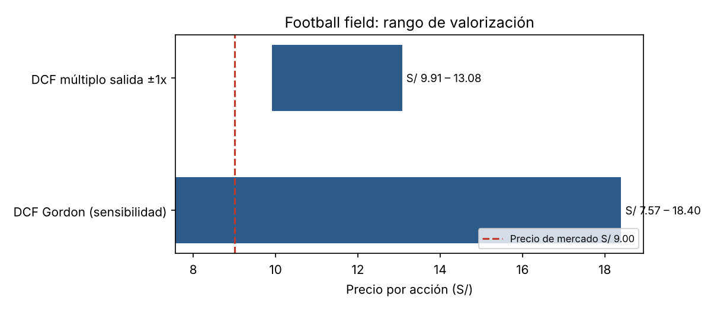

# 01 · Valorización DCF de una empresa de la BVL

**Área:** Banca de Inversión · Finanzas Corporativas

Modelo de Flujo de Caja Descontado (FCFF) en Python, con la estructura que se usa en un *equity research* o en un *fairness opinion*:

- **Proyección operativa** a 5 años: ventas, EBITDA, D&A, capex y capital de trabajo.
- **WACC para Perú**: CAPM con beta reapalancado (Hamada), prima por riesgo país (EMBIG Perú) y conversión de USD a soles por paridad de inflación (Fisher). Tasa de impuesto a la renta de 29.5%.
- **Valor terminal** por dos métodos: crecimiento perpetuo (Gordon) y múltiplo de salida EV/EBITDA.
- **Convención de medio año** en el descuento de flujos.
- **Tabla de sensibilidad** WACC vs. *g* y gráfico *football field*.
- Exportación a **Excel** para revisión.

## Cómo correrlo

```bash
python dcf.py --excel
```

Todos los supuestos están en [`supuestos.json`](supuestos.json). Los valores incluidos son **ilustrativos**: para un análisis real, reemplázalos con los estados financieros auditados de la empresa publicados en la [SMV](https://www.smv.gob.pe), el EMBIG Perú del BCRP y la beta de comparables.

## Salida de ejemplo (supuestos ilustrativos)

| Concepto | Valor |
|---|---|
| WACC (S/) | 9.1% |
| Precio objetivo (Gordon) | S/ 11.22 |
| Precio objetivo (múltiplo 8x) | S/ 11.49 |
| Valor terminal / EV | 75% |



## Qué demuestra

Dominio de la mecánica de valorización, del cálculo de costo de capital en un mercado emergente y de la presentación de resultados con rangos y sensibilidades, en lugar de un único número.
