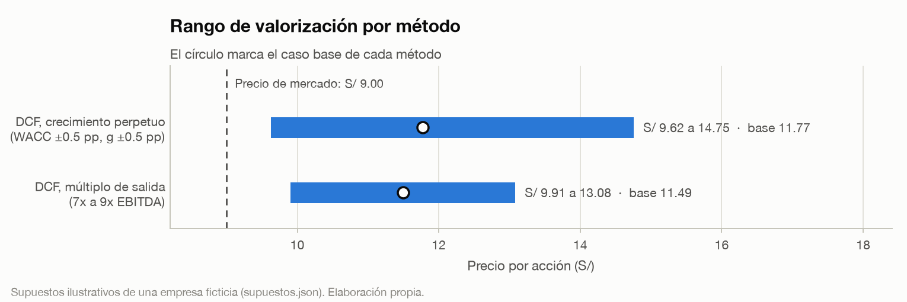
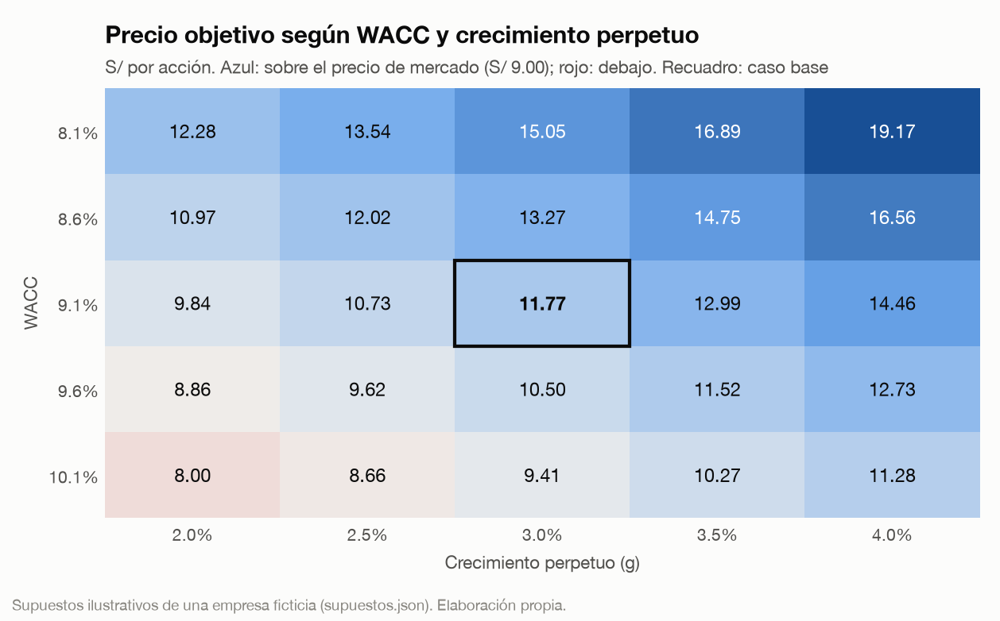

# 01 · Valorización DCF de una empresa de la BVL

**Área:** Banca de Inversión · Finanzas Corporativas

**Pregunta:** ¿cuánto vale la acción y qué tan sensible es esa cifra a los supuestos?



## Qué hace

Modelo de flujo de caja descontado (FCFF) con la estructura de un informe de *equity research*:

1. **WACC en soles.** CAPM con beta reapalancado (Hamada) y prima por riesgo país (EMBIG Perú), convertido de dólares a soles por diferencial de inflación. Impuesto a la renta de 29.5%.
2. **Proyección a cinco años** de ventas, EBITDA, depreciación, capex y capital de trabajo.
3. **Valor terminal por dos métodos**: crecimiento perpetuo (Gordon) y múltiplo de salida EV/EBITDA.
4. **Control cruzado.** Cada método reporta el supuesto que implica en el otro: qué múltiplo equivale al crecimiento perpetuo elegido y qué crecimiento equivale al múltiplo elegido. Si las dos cifras no conversan, uno de los supuestos está mal.
5. **Sensibilidad** al WACC y al crecimiento perpetuo.
6. **El mismo modelo en Excel, con fórmulas vivas:** se cambia un supuesto y el precio objetivo se recalcula.

## Resultados (empresa ficticia)

| Concepto | Valor |
|---|---|
| WACC en soles | 9.1% |
| Precio objetivo, crecimiento perpetuo de 3.0% | S/ 11.77 |
| Precio objetivo, múltiplo de salida de 8.0x | S/ 11.49 |
| Valor terminal sobre el valor de la firma | 76% |
| Control cruzado | Crecer 3.0% a perpetuidad equivale a vender a 8.2x EBITDA; vender a 8.0x equivale a crecer 2.9% |



## Una decisión que cambia el resultado

Con la convención de medio año, el flujo del año *t* se descuenta *t* − 0.5 años. El valor terminal de Gordon es una perpetuidad de flujos que también llegan a mitad de año, así que se descuenta *N* − 0.5 años. El de múltiplo de salida es el precio de una venta al cierre del año *N* y se descuenta *N* años. Descontar ambos *N* años, un error frecuente, subestima el valor de Gordon en (1 + WACC)^0.5: aquí, 4.5% del valor terminal y S/ 0.55 por acción.

## El modelo en Excel

[`resultados/modelo_dcf.xlsx`](resultados/modelo_dcf.xlsx) es el mismo modelo, escrito celda por celda como fórmulas por [`modelo_excel.py`](modelo_excel.py). Sirve para lo que una tabla de resultados no permite: cambiar un supuesto y ver qué pasa con el precio.

| Hoja | Contenido |
|---|---|
| Supuestos | Todos los datos de entrada, en azul |
| WACC | Beta apalancado, costo del capital propio en dólares y en soles, costo de la deuda y ponderación |
| Proyección | De las ventas al flujo de caja libre, año por año |
| Valorización | Descuento con convención de medio año, los dos valores terminales, el puente al precio por acción y el control cruzado |
| Sensibilidad | El precio objetivo para 25 combinaciones de WACC y crecimiento perpetuo, cada una con su propia fórmula |
| Comprobación | Lo que calcula Excel frente a lo que calculó Python, y la diferencia |

Tres reglas de construcción:

- **Los supuestos viven en una sola hoja.** En las hojas de cálculo no hay ninguna cifra escrita a mano, salvo el medio año con que empieza el descuento. Una prueba automática lo verifica.
- **Azul para los supuestos y negro para las fórmulas,** la convención de los modelos financieros.
- **El modelo se comprueba.** La hoja «Comprobación» dice «Sí» mientras las fórmulas reproduzcan el cálculo de Python. Además, las pruebas calculan el libro con un motor de fórmulas independiente de Excel y lo comparan con Python para tres juegos de supuestos, uno de ellos con tres años de proyección en lugar de cinco.

El archivo guarda las fórmulas, no sus resultados: hay que abrirlo con Excel, LibreOffice o Google Sheets, que las calculan al abrir.

## Cómo correrlo

```bash
python 01-valorizacion-dcf/dcf.py --excel
python 01-valorizacion-dcf/dcf.py --supuestos mi_empresa.json
```

Todos los supuestos están en [`supuestos.json`](supuestos.json).

## Límites

- **La empresa es ficticia.** Los órdenes de magnitud son los de una empresa de consumo masivo de la BVL, pero ninguna cifra corresponde a una compañía real. Para valorizar una empresa de verdad hay que reemplazar el archivo de supuestos con sus estados financieros auditados ([SMV](https://www.smv.gob.pe)), el EMBIG vigente y la beta de comparables.
- **El 76% del valor está en el valor terminal.** El precio depende sobre todo de dos números (WACC y *g*) que no se observan. Por eso el resultado útil es el rango, no el punto.
- La prima por riesgo país entra completa al costo del capital propio. Es la práctica más común, pero supone que la empresa está tan expuesta al riesgo país como el bono soberano.

## Referencias

- Damodaran, A. (2012). *Investment Valuation* (3.ª ed.). Wiley.
- Hamada, R. (1972). The effect of the firm's capital structure on the systematic risk of common stocks. *Journal of Finance*, 27(2).
- Rosenbaum, J. y Pearl, J. (2020). *Investment Banking: Valuation, LBOs, M&A, and IPOs* (3.ª ed.). Wiley.
