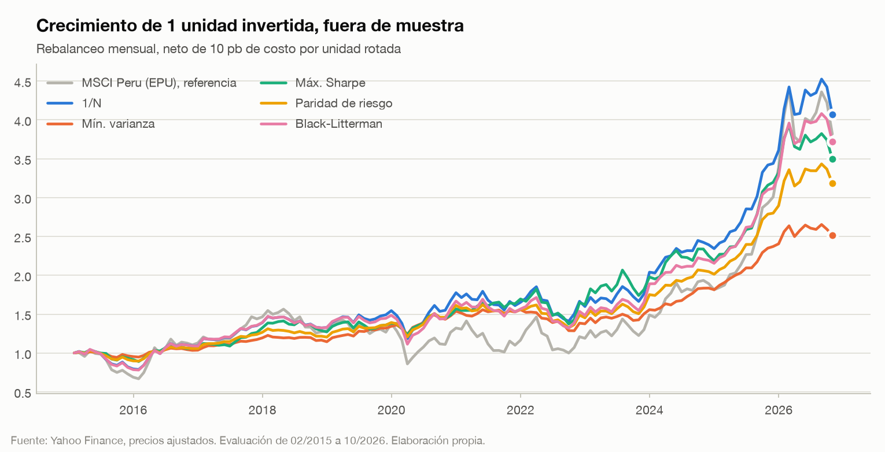
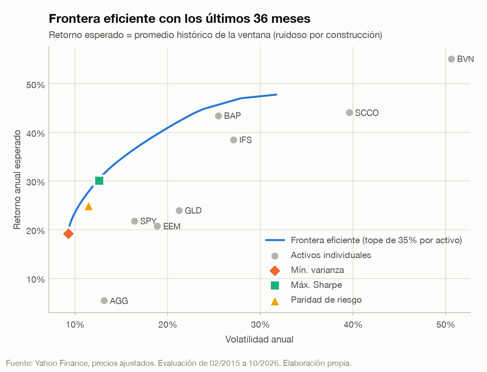

# 02 · Optimización de portafolio: Perú y diversificadores globales

**Área:** Asset Management · Inversiones

**Pregunta:** ¿le gana un portafolio optimizado a repartir el dinero en partes iguales?



## Qué hace

Compara cinco formas de armar un portafolio con acciones peruanas listadas en Nueva York (Credicorp, Southern Copper, Buenaventura, Intercorp Financial) y diversificadores globales (S&P 500, emergentes, bonos y oro), frente al ETF MSCI Peru (EPU).

| Estrategia | Idea |
|---|---|
| 1/N | Pesos iguales. La referencia ingenua, difícil de vencer |
| Mínima varianza | Solo usa la matriz de covarianzas |
| Máximo Sharpe | Markowitz, con tope de 35% por activo |
| Paridad de riesgo | Cada activo aporta el mismo riesgo |
| Black-Litterman | Punto de partida neutral más dos vistas del analista |

**Cómo se evalúa.** Ventana móvil de 36 meses y rebalanceo mensual. Los pesos de cada mes se calculan solo con retornos anteriores a ese mes (hay una prueba que lo verifica). La covarianza se estima con contracción de Ledoit-Wolf. Los resultados son netos de 10 pb por unidad de portafolio rotada. Un activo entra al universo cuando completa 36 meses de historia: Intercorp Financial cotiza desde 2019 y entra en 2022.

## Resultados (febrero de 2015 a octubre de 2026, 141 meses)

| Estrategia | Retorno anual | Volatilidad | Sharpe | Máxima caída | Rotación anual |
|---|---|---|---|---|---|
| 1/N | 12.7% | 17.2% | 0.55 | −24.5% | 53% |
| Mínima varianza | 8.2% | 8.8% | 0.49 | −17.4% | 57% |
| Máximo Sharpe | 11.2% | 14.8% | 0.52 | −24.6% | 222% |
| Paridad de riesgo | 10.4% | 11.7% | 0.56 | −18.3% | 52% |
| Black-Litterman | 11.8% | 16.7% | 0.52 | −25.4% | 69% |
| MSCI Peru (EPU) | 12.1% | 25.3% | 0.42 | −45.0% | |

**Lectura.**

- Ninguna estrategia optimizada le gana con claridad a 1/N en Sharpe. Es el resultado conocido de DeMiguel, Garlappi y Uppal (2009): con ventanas cortas, el error de estimación de los retornos esperados se come la ganancia teórica.
- Máximo Sharpe es la que más depende de esos retornos esperados y la que más rota: 2.2 veces el portafolio al año.
- Diversificar sí paga frente a la bolsa peruana sola: todas las estrategias tienen mejor Sharpe que el EPU y alrededor de la mitad de su caída máxima.
- Paridad de riesgo consigue el Sharpe de 1/N con un tercio menos de volatilidad sin pronosticar retornos.



## Cómo correrlo

```bash
python 02-optimizacion-portafolio/optimizacion.py            # precios reales (Yahoo Finance)
python 02-optimizacion-portafolio/optimizacion.py --demo     # retornos simulados, sin conexión
python 02-optimizacion-portafolio/optimizacion.py --costo-pb 25
```

Genera `backtest.png`, `frontera.png`, `metricas.csv` y `pesos_actuales.csv` en `resultados/`.

## Límites

- **Las diferencias de Sharpe no son estadísticamente distinguibles** con 141 meses: 0.55 frente a 0.49 no permite elegir un ganador.
- El punto de partida de Black-Litterman es 1/N y no la capitalización de mercado, que no tiene una definición natural cuando se mezclan acciones y ETF. Las dos vistas son ilustrativas y fijas en todo el periodo.
- El universo se eligió hoy: son empresas que sobrevivieron y siguen listadas (sesgo de supervivencia).
- El costo de 10 pb es un supuesto. Para las acciones peruanas menos líquidas el costo real es mayor.

## Referencias

- Black, F. y Litterman, R. (1992). Global portfolio optimization. *Financial Analysts Journal*, 48(5).
- DeMiguel, V., Garlappi, L. y Uppal, R. (2009). Optimal versus naive diversification: how inefficient is the 1/N portfolio strategy? *Review of Financial Studies*, 22(5).
- Ledoit, O. y Wolf, M. (2004). A well-conditioned estimator for large-dimensional covariance matrices. *Journal of Multivariate Analysis*, 88(2).
- Maillard, S., Roncalli, T. y Teïletche, J. (2010). The properties of equally weighted risk contribution portfolios. *Journal of Portfolio Management*, 36(4).
