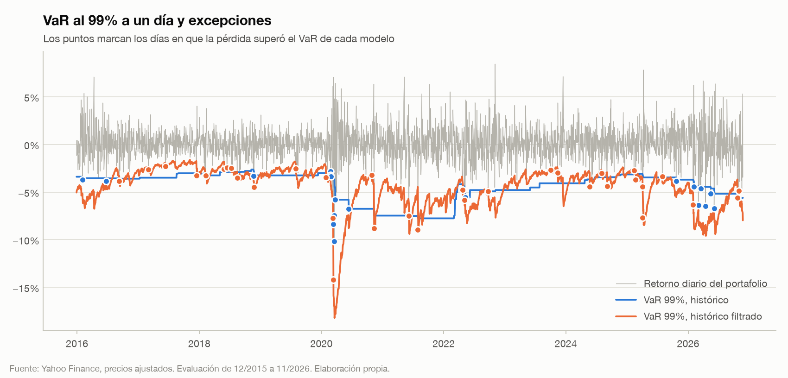
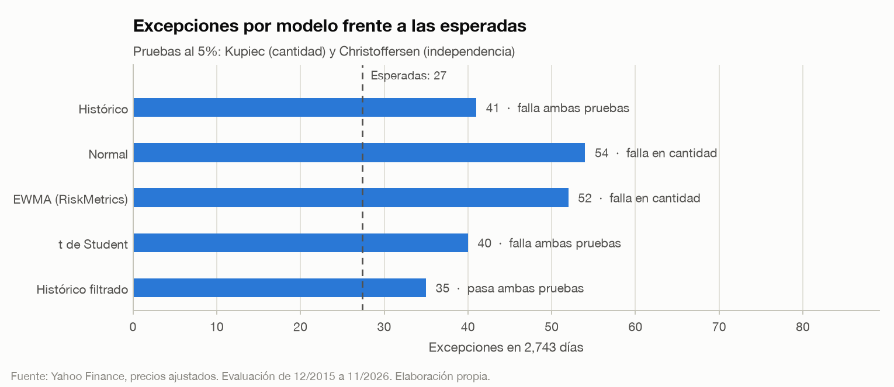

# 03 · VaR, Expected Shortfall y backtesting regulatorio

**Área:** Gestión de Riesgo de Mercado

**Pregunta:** ¿qué modelo de VaR sobrevive a las pruebas que le haría un área de riesgos o el regulador?



## Qué hace

Mide el riesgo diario de un portafolio de USD 1 millón en Credicorp (35%), Southern Copper (30%), Buenaventura (15%) y el ETF MSCI Peru (20%), con cinco modelos de VaR y Expected Shortfall al 99% a un día sobre una ventana móvil de 500 días:

| Modelo | Supuesto |
|---|---|
| Histórico | El futuro se parece a los últimos 500 días |
| Normal | Retornos normales con la volatilidad de la ventana |
| EWMA / RiskMetrics | Normal, con volatilidad que pondera más lo reciente (λ = 0.94) |
| t de Student | Colas pesadas, con la volatilidad de la ventana |
| Histórico filtrado | Los retornos pasados se reescalan a la volatilidad de hoy (Hull y White, 1998) |

Cada modelo se valida con tres pruebas:

- **Kupiec:** ¿el número de excepciones es el esperado (1% de los días)?
- **Christoffersen:** ¿las excepciones son independientes o llegan en racimo?
- **Semáforo de Basilea** sobre los últimos 250 días: verde hasta 4 excepciones, amarillo de 5 a 9, rojo desde 10.

## Resultados (diciembre de 2015 a noviembre de 2026, 2 743 días)



| Modelo | Excepciones (esperadas: 27) | Kupiec, p | Independencia, p | Basilea, 250 días | VaR hoy (USD) |
|---|---|---|---|---|---|
| Histórico | 41 | 0.015 | 0.025 | Amarillo | 56 045 |
| Normal | 54 | 0.000 | 0.114 | Rojo | 44 932 |
| EWMA / RiskMetrics | 52 | 0.000 | 0.359 | Amarillo | 62 738 |
| t de Student | 40 | 0.024 | 0.021 | Rojo | 52 456 |
| **Histórico filtrado** | **35** | **0.164** | **0.470** | **Verde** | **79 670** |

**Lectura.** Cada modelo simple falla por una razón distinta, y el filtrado corrige las dos:

- El **normal** y el **EWMA** subestiman las colas: casi el doble de excepciones de lo esperado. El EWMA acierta el *momento* (sus excepciones son independientes) pero no la *magnitud*.
- El **histórico** y la **t** captan mejor las colas, pero reaccionan tarde: sus excepciones llegan agrupadas cuando sube la volatilidad, como en marzo de 2020.
- El **histórico filtrado** combina las colas empíricas con una volatilidad que se actualiza a diario. Es el único que pasa ambas pruebas al 5% y el único en zona verde.

Hoy el VaR del modelo filtrado es 42% mayor que el del histórico (USD 79 670 frente a 56 045), porque la volatilidad reciente es más alta que la del promedio de la ventana.

## Cómo correrlo

```bash
python 03-var-backtesting/var_backtesting.py          # precios reales (Yahoo Finance)
python 03-var-backtesting/var_backtesting.py --demo   # retornos simulados GARCH(1,1) con colas pesadas
```

Genera `var_excepciones.png`, `backtesting.png` y `backtesting.csv` en `resultados/`.

## Límites

- **El portafolio tiene pesos fijos y solo posiciones lineales.** Con opciones o renta fija haría falta revaluar cada posición.
- El horizonte es de un día. Escalar a 10 días con la raíz del tiempo supone retornos independientes, justo lo que la prueba de Christoffersen rechaza para varios modelos.
- Se valida el VaR, no el ES. Basilea migró al ES, que es más difícil de validar porque no es elicitable.
- Las pruebas tienen poca potencia con 1% de excepciones: no rechazar no prueba que el modelo sea correcto.

## Referencias

- Basel Committee on Banking Supervision (1996). *Supervisory framework for the use of "backtesting" in conjunction with the internal models approach to market risk capital requirements*.
- Christoffersen, P. (1998). Evaluating interval forecasts. *International Economic Review*, 39(4).
- Hull, J. y White, A. (1998). Incorporating volatility updating into the historical simulation method for value-at-risk. *Journal of Risk*, 1(1).
- Kupiec, P. (1995). Techniques for verifying the accuracy of risk measurement models. *Journal of Derivatives*, 3(2).
