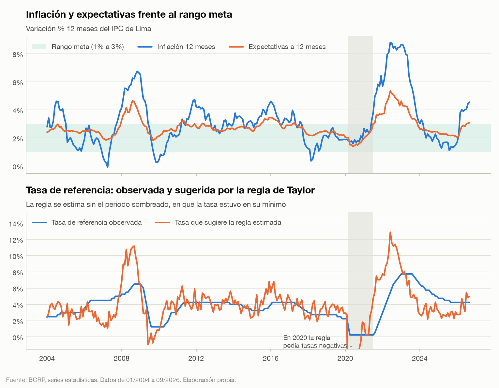
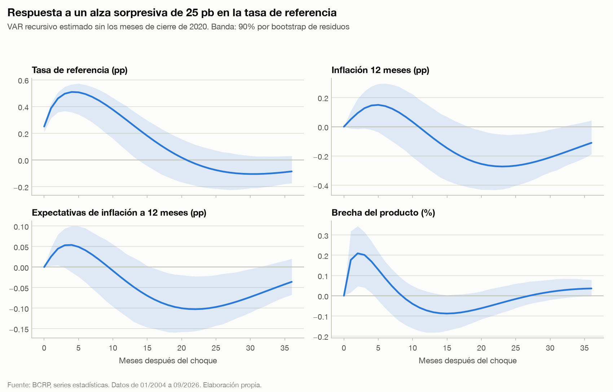
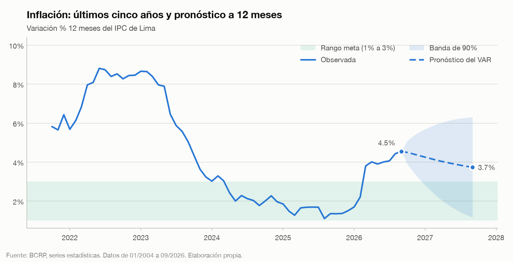

# 04 · Inflación y política monetaria del BCRP

**Área:** Estudios Económicos · Investigación

Tres preguntas sobre la política monetaria peruana, respondidas con datos de la [API de series estadísticas del BCRP](https://estadisticas.bcrp.gob.pe/estadisticas/series/) (enero de 2004 a septiembre de 2026, 273 meses).

## 1. ¿A qué responde el BCRP?

Regla de Taylor con suavizamiento, estimada por MCO con errores HAC:

`i_t = c + ρ·i_{t−1} + a·(π_t − 2%) + b·brecha_t + e_t`

Se reportan los coeficientes de largo plazo, φπ = a/(1 − ρ) y φy = b/(1 − ρ), con errores estándar por el método delta.

| | Inflación observada | Inflación observada, sin 2020-21 | Expectativas a 12 meses | Expectativas, sin 2020-21 |
|---|---|---|---|---|
| ρ (suavizamiento) | 0.94 (0.01) | 0.94 (0.01) | 0.94 (0.01) | 0.94 (0.01) |
| φπ (respuesta a la inflación) | 1.02 (0.21) | 0.89 (0.21) | **2.97 (0.35)** | **2.81 (0.47)** |
| φy (respuesta a la brecha) | 0.36 (0.09) | 1.00 (0.52) | 0.24 (0.07) | 0.78 (0.45) |
| Observaciones | 272 | 255 | 272 | 255 |

**El BCRP responde a las expectativas, no a la inflación del mes.** Frente a la inflación observada, φπ no se distingue de 1: el banco no sube la tasa real cuando sube el IPC, que en el Perú se mueve mucho por alimentos y energía. Frente a las expectativas a 12 meses, φπ es cercano a 3 y cumple con holgura el principio de Taylor (φπ > 1).



Las columnas «sin 2020-21» excluyen de marzo de 2020 a julio de 2021, cuando la tasa estuvo en su mínimo de 0.25% y una regla lineal no puede describirla: la regla pedía tasas negativas.

## 2. ¿Qué pasa con la inflación después de un alza de la tasa?

VAR recursivo con cinco variables (brecha del producto, inflación, expectativas, tasa de referencia y depreciación, en ese orden), dos rezagos elegidos por BIC y bandas de 90% por bootstrap de residuos.



- Un alza sorpresiva de 25 pb suele ser el inicio de un ciclo: la tasa llega a +0.51 pp en el cuarto mes y vuelve a cero hacia el mes 21.
- La inflación responde con rezago: el efecto máximo es de **−0.27 pp en el mes 23** (banda de 90%: −0.43 a −0.05).
- En los primeros meses la inflación *sube* 0.15 pp, aunque la banda incluye el cero. Es el *price puzzle* (Sims, 1992): el banco sube la tasa porque anticipa inflación, y el VAR confunde esa anticipación con un efecto de la tasa. Sin las expectativas en el VAR, la subida inicial es de 0.23 pp y es estadísticamente significativa; incluirlas la reduce en un tercio.

## 3. ¿Hacia dónde va la inflación?



El VAR proyecta que la inflación baja de 4.5% a 3.7% en doce meses, con una banda de 90% que va de 1.2% a 6.3%. Dos advertencias que el gráfico no muestra:

- **El dato de octubre de 2026 ya salió y fue 5.25%**, por encima de la banda de ese mes (3.9% a 5.1%). No entró al modelo porque el PBI de octubre aún no se publica y la muestra termina donde termina la serie más rezagada.
- **El VAR apenas le gana al pronóstico ingenuo** («la inflación se queda donde está»). Evaluado mes a mes desde 2012, solo con los datos disponibles en cada fecha:

| Horizonte | Error del VAR (pp) | Error del ingenuo (pp) | VAR / ingenuo |
|---|---|---|---|
| 1 mes | 0.37 | 0.40 | 0.94 |
| 3 meses | 0.80 | 0.84 | 0.96 |
| 6 meses | 1.28 | 1.36 | 0.94 |
| 12 meses | 1.88 | 2.14 | 0.88 |

La ventaja es de 4% a 12% y excluye los pronósticos hechos desde un mes de cierre de 2020. Con ellos, el VAR pierde frente al ingenuo en todos los horizontes (cociente de 1.02 a 1.85).

## Decisiones de método

- **Brecha del producto.** Filtro HP (λ = 14 400) sobre el PBI desestacionalizado, con la tendencia estimada *sin* los meses de cierre. Si esos meses entran al filtro, la caída de 2020 arrastra la tendencia y aparece una brecha positiva ficticia de 5% a 6% justo antes de la pandemia.
- **Pandemia en el VAR.** Las filas en que un mes de marzo a diciembre de 2020 aparece como variable dependiente o como rezago no entran en la estimación. Un mes en que el PBI cae 39% no informa sobre la dinámica normal de la economía (sobre el tratamiento de estas observaciones, Lenza y Primiceri, 2022).
- **VAR propio.** [`var_recursivo.py`](var_recursivo.py) implementa la estimación, las impulso-respuesta y el bootstrap con `numpy`. Las pruebas verifican que da los mismos coeficientes que `statsmodels`.
- **Datos validados.** Cada serie se comprueba contra su nombre oficial al descargarla ([`common/data.py`](../common/data.py)).

## Cómo correrlo

```bash
python 04-inflacion-bcrp/inflacion_bcrp.py          # datos del BCRP
python 04-inflacion-bcrp/inflacion_bcrp.py --demo   # economía simulada con parámetros conocidos
python 04-inflacion-bcrp/inflacion_bcrp.py --lambda-hp 129600 --rezagos 4
```

En modo demo la regla de Taylor recupera los parámetros con que se simuló la economía (φπ = 1.5, φy = 0.5), lo que sirve de control del estimador.

## Límites

- **La identificación recursiva es débil.** Supone que la tasa no afecta a la actividad ni a los precios dentro del mismo mes y que el VAR contiene toda la información del banco central. El *price puzzle* muestra que no es así. La alternativa moderna es identificar con sorpresas de alta frecuencia y proyecciones locales.
- **La regla de Taylor por MCO es descriptiva.** La inflación y la brecha responden a la tasa, así que los coeficientes pueden estar sesgados. La alternativa es estimar por GMM con instrumentos (Clarida, Galí y Gertler, 2000).
- El VAR usa tasas a 12 meses, que son muy persistentes. La prueba ADF no rechaza la raíz unitaria en la depreciación al 5% (p = 0.052).
- Las bandas del pronóstico no incluyen la incertidumbre de los parámetros, así que son más angostas de lo debido.
- La brecha con filtro HP es sensible al final de la muestra y al valor de λ (Ravn y Uhlig, 2002, proponen 129 600 para datos mensuales).

## Referencias

- Clarida, R., Galí, J. y Gertler, M. (2000). Monetary policy rules and macroeconomic stability: evidence and some theory. *Quarterly Journal of Economics*, 115(1).
- Lenza, M. y Primiceri, G. (2022). How to estimate a vector autoregression after March 2020. *Journal of Applied Econometrics*, 37(4).
- Ravn, M. y Uhlig, H. (2002). On adjusting the Hodrick-Prescott filter for the frequency of observations. *Review of Economics and Statistics*, 84(2).
- Sims, C. (1992). Interpreting the macroeconomic time series facts: the effects of monetary policy. *European Economic Review*, 36(5).
- Taylor, J. (1993). Discretion versus policy rules in practice. *Carnegie-Rochester Conference Series on Public Policy*, 39.
