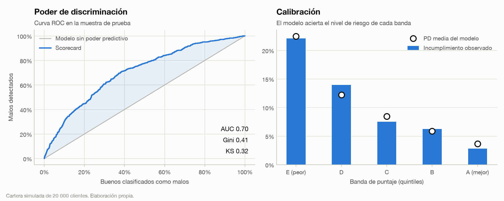
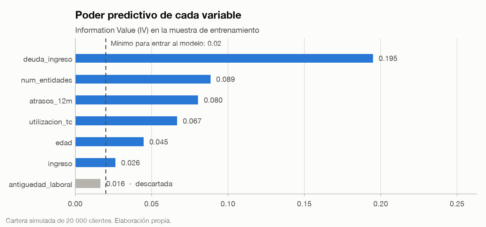

# 05 · Scorecard de riesgo de crédito y pérdida esperada

**Área:** Gestión de Riesgo de Crédito · Banca

**Pregunta:** ¿cómo se convierte una cartera de créditos en puntajes, bandas de riesgo y pérdida esperada?



## Qué hace

Construye una tarjeta de puntaje para créditos de consumo con la metodología estándar de admisión y provisiones:

1. **WoE e Information Value.** Cada variable se agrupa en tramos y se mide cuánto separa a buenos de malos pagadores. Admite variables numéricas, categóricas y datos faltantes, que forman su propio tramo.
2. **Regresión logística** sobre las variables transformadas a WoE, lo que da coeficientes estables e interpretables.
3. **Validación** en una muestra que el modelo no vio (30% de los clientes): AUC, Gini, KS y PSI.
4. **Puntaje.** 600 puntos equivalen a 50 buenos por cada malo, y cada 20 puntos duplican esa razón. La tarjeta asigna puntos a cada tramo de cada variable.
5. **Pérdida esperada** `EL = PD × LGD × EAD` por banda de puntaje, la base de las provisiones y del precio del crédito.

## Resultados (cartera simulada de 20 000 clientes)

| Métrica | Valor | Lectura |
|---|---|---|
| AUC | 0.70 | |
| Gini | 0.41 | Poder de discriminación medio |
| KS | 0.32 | |
| PSI, entrenamiento frente a prueba | 0.002 | Población estable (menos de 0.10) |
| Pérdida esperada | 6.3% de la exposición | Con LGD de 65% |

El incumplimiento observado baja de 22.1% en la banda E a 2.8% en la banda A, y la PD del modelo sigue ese orden de cerca (22.5% y 3.6%).



**La tarjeta suma el puntaje del modelo.** Los puntos de un cliente son 549 puntos base más los de cada tramo en que cae. Una prueba verifica que esa suma coincide con el puntaje que sale de la regresión para todos los clientes, con una diferencia máxima de 2 × 10⁻¹³. La tarjeta está en [`resultados/tarjeta_puntaje.txt`](resultados/tarjeta_puntaje.txt).

## Cómo correrlo

```bash
python 05-riesgo-credito/scorecard.py                                         # cartera simulada
python 05-riesgo-credito/scorecard.py --csv cartera.csv                       # datos propios
python 05-riesgo-credito/scorecard.py --csv datos.csv --objetivo mora --saldo exposicion
```

El archivo propio necesita una columna 0/1 de incumplimiento (`default`, o la que se indique con `--objetivo`). La columna de saldo es opcional: sin ella, la pérdida esperada se reporta con una exposición de 1 por cliente.

## Límites

- **Los datos son simulados.** El incumplimiento se genera con un modelo logístico conocido, así que el Gini de 0.41 dice que el método recupera la señal que hay, no que estas variables predigan así en una cartera real.
- **Solo hay clientes aprobados.** Una cartera real no observa a los rechazados (sesgo de selección), y corregirlo requiere inferencia de rechazados.
- Los tramos se forman por cuantiles, sin exigir que el riesgo sea monótono entre tramos. Un área de riesgos los ajustaría a mano.
- La LGD de 65% es un supuesto único. En la práctica se estima por producto y garantía.
- No hay dimensión temporal: falta validar fuera de tiempo y separar la PD del ciclo de la PD a lo largo del ciclo.

## Referencias

- Siddiqi, N. (2017). *Intelligent Credit Scoring: Building and Implementing Better Credit Risk Scorecards* (2.ª ed.). Wiley.
