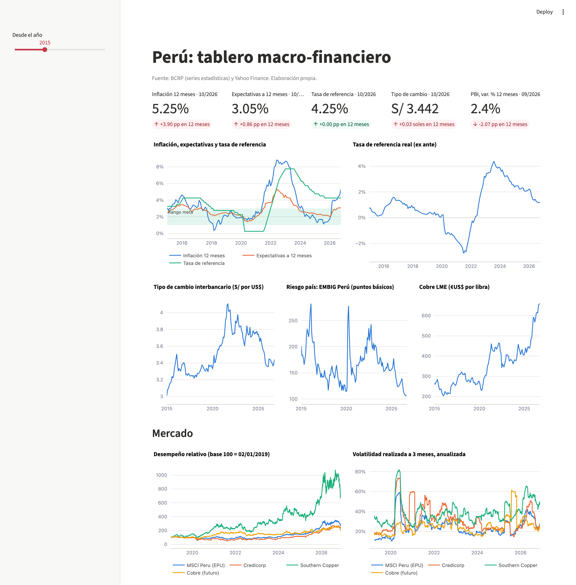

# 06 · Tablero macro-financiero del Perú

**Área:** transversal (Estudios Económicos, Asset Management, Tesorería)

**Pregunta:** ¿qué mira un analista cada mañana antes de opinar sobre el Perú?



## Qué muestra

Aplicación web en **Streamlit y Plotly**, con datos del BCRP y de Yahoo Finance:

- **Indicadores:** inflación, expectativas de inflación a 12 meses, tasa de referencia, tipo de cambio y PBI, cada uno con su cambio en 12 meses y la fecha del último dato.
- **Política monetaria:** inflación y expectativas frente al rango meta, y la tasa de referencia real *ex ante* (tasa menos expectativas), que dice si la política aprieta o estimula.
- **Sector externo:** tipo de cambio, riesgo país (EMBIG Perú) y precio del cobre.
- **Mercado:** desempeño del MSCI Peru, Credicorp, Southern Copper y el cobre, y su volatilidad realizada.
- **Dependencia del cobre:** correlación móvil de seis meses de los activos peruanos con el cobre.

Los datos se guardan en caché seis horas. Cada serie del BCRP se valida contra su nombre oficial antes de mostrarse ([`common/data.py`](../common/data.py)).

## Cómo correrlo

```bash
streamlit run 06-dashboard-macro/app.py              # datos reales
streamlit run 06-dashboard-macro/app.py -- --demo    # datos simulados, sin conexión
```

Para publicarlo con un enlace propio basta conectar este repositorio en [Streamlit Community Cloud](https://streamlit.io/cloud) e indicar `06-dashboard-macro/app.py` como archivo principal.

## Límites

- La correlación con el cobre describe cuánto se mueven juntos los retornos, no causalidad.
- Yahoo Finance no es una fuente oficial y a veces corta las descargas: el tablero reintenta y, si no logra datos completos, muestra el error en lugar de un gráfico a medias.
- Las series del BCRP se publican con rezagos distintos (el PBI, dos meses), y por eso cada indicador lleva su propia fecha.
