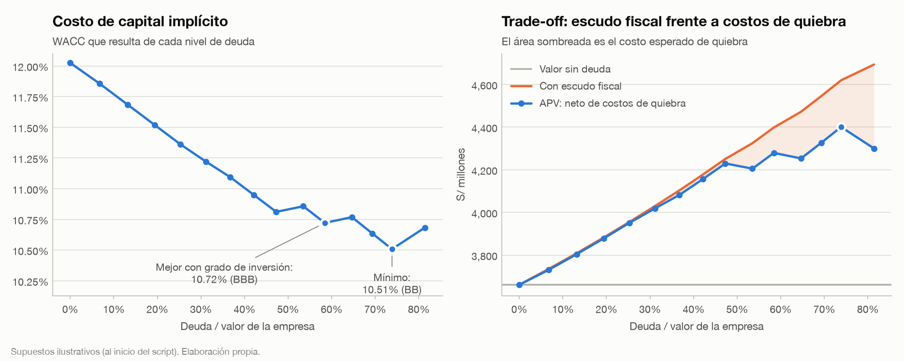
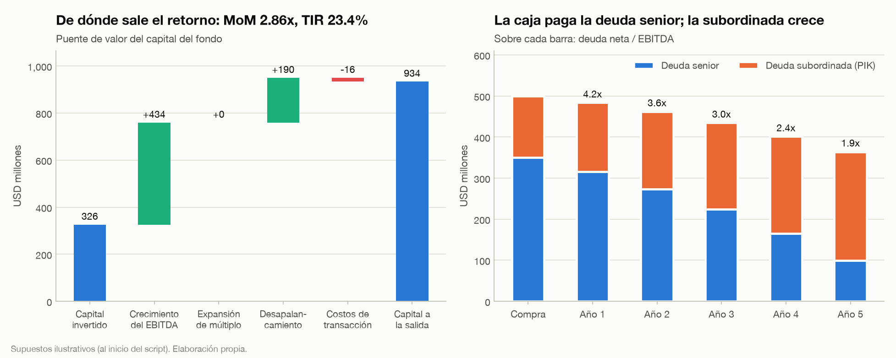
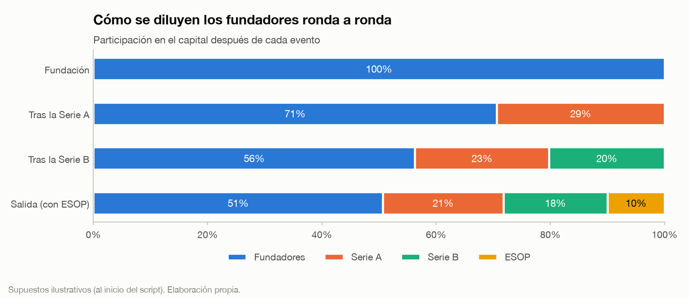
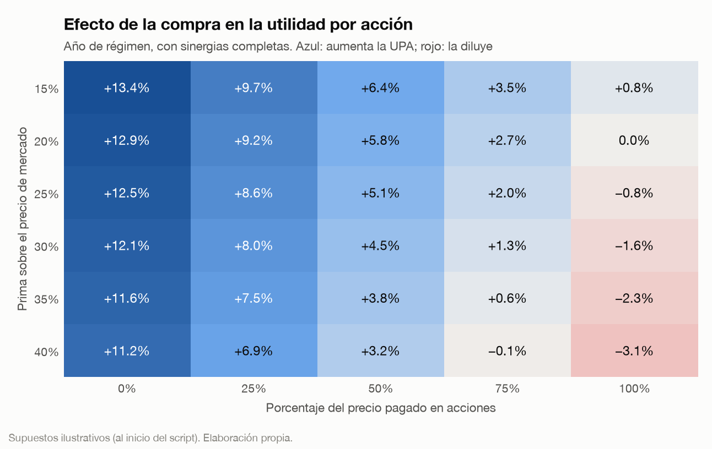

# 07 · Finanzas corporativas avanzadas

**Área:** Banca de Inversión · Private Equity · Finanzas Corporativas

Cuatro modelos sobre los temas que estudié en **FM350 Advanced Corporate Finance** (LSE Summer School, agosto de 2026): estructura de capital, private equity, venture capital y fusiones. Los modelos, el código y los supuestos son míos y están adaptados a empresas peruanas. No incluyen material ni casos del curso.

| Script | Pregunta | Resultado con los supuestos ilustrativos |
|---|---|---|
| [`estructura_capital.py`](estructura_capital.py) | ¿Cuánta deuda debería tomar una empresa sin apalancamiento? | El valor máximo está en D/V = 74% (rating BB); quedarse en grado de inversión (BBB, 58%) cuesta 2.8% del valor |
| [`lbo.py`](lbo.py) | ¿Qué retorno obtiene un fondo que compra la empresa con deuda? | TIR de 23.4% y 2.86 veces el capital en cinco años |
| [`venture_capital.py`](venture_capital.py) | ¿Qué participación debe pedir un inversionista en una fintech? | 29.4% hoy para terminar con 21.1% tras la dilución; valor post-money de USD 10.2 millones |
| [`fusiones.py`](fusiones.py) | ¿Crea valor comprar a un competidor y qué le pasa a la utilidad por acción? | Las sinergias valen S/ 825 millones frente a una prima de S/ 450 millones |

## Estructura de capital: trade-off y APV



Para cada nivel de deuda, el modelo asigna un rating sintético según la cobertura de intereses, valora el escudo fiscal y le resta el costo esperado de quiebra: `APV = valor sin deuda + escudo fiscal − costos esperados de quiebra`. El WACC implícito es la tasa que, aplicada al mismo flujo, da ese valor, así que su mínimo coincide por construcción con el máximo del APV.

**Lectura.** El modelo recomienda mucha más deuda de la que toman las empresas reales. No es un error del código sino un rasgo conocido del trade-off de libro de texto: valora el escudo fiscal completo (t·D) y solo descuenta 20% de valor en caso de quiebra. Fuera quedan los impuestos personales, la pérdida de flexibilidad financiera y los costos de agencia. Graham (2000) documenta la misma brecha en los datos. Por eso la comparación útil es la segunda: bajar a grado de inversión cuesta apenas 2.8% del valor.

## LBO: de dónde sale el retorno



Compra a 8.0x EBITDA con 5.0x de deuda (3.5x senior con *cash sweep* de 75% y 1.5x subordinada con intereses capitalizados). El capital del fondo pasa de USD 326 millones a USD 934 millones. El puente separa las fuentes: USD 434 millones por crecimiento del EBITDA, USD 190 millones por desapalancamiento y nada por expansión de múltiplo, porque se supone que se vende al mismo múltiplo al que se compró. La TIR va de 12.7% a 37.2% según los múltiplos de entrada y de salida ([tabla](resultados/lbo_sensibilidad_tir.csv)).

## Venture capital: dilución ronda a ronda



El método parte del valor a la salida (USD 108 millones) y calcula hacia atrás. Para una TIR objetivo de 50%, la Serie A necesita 21.1% de la empresa al final; como después vienen una Serie B y un pool de opciones de 10%, hoy debe pedir 29.4%. El contraste por escenarios muestra por qué la TIR objetivo es tan alta: 50% es el retorno si todo sale bien. Ponderando por la probabilidad de cada escenario (30% de éxito, 40% mediocre, 30% de fracaso), el retorno esperado de la Serie A es de 24.9% anual.

## M&A: que suba la UPA no significa que se cree valor



La operación crea valor en todos los casos de la tabla: las sinergias (S/ 825 millones, netas de integración) superan a la prima (S/ 450 millones). Aun así, pagada 100% en acciones diluye la utilidad por acción en 1.6%, porque el comprador entrega acciones que cotizan a 8.5 veces utilidades para comprar utilidades que paga a 16.2 veces. El efecto en la UPA depende de la forma de pago y de los P/E relativos; la creación de valor, de las sinergias frente a la prima.

## Cómo correrlos

```bash
python 07-lse-fm350/estructura_capital.py
python 07-lse-fm350/lbo.py
python 07-lse-fm350/venture_capital.py
python 07-lse-fm350/fusiones.py
```

No necesitan conexión. Los supuestos están al inicio de cada script.

## Límites

- **Todos los supuestos son ilustrativos.** Las empresas no existen y las cifras no vienen de estados financieros.
- La tabla de ratings (cobertura, spread y probabilidad de incumplimiento) tiene la forma de las que se usan en la práctica, pero no reproduce las cifras de ninguna agencia.
- El LBO no modela una línea revolvente ni *covenants*; el flujo de caja alcanza para la amortización obligatoria en todos los años.
- El análisis de UPA no incluye la asignación del precio de compra (amortización de intangibles), que en una operación real reduce la utilidad proforma.

## Referencias

- Andrade, G. y Kaplan, S. (1998). How costly is financial (not economic) distress? Evidence from highly leveraged transactions that became distressed. *Journal of Finance*, 53(5).
- Graham, J. (2000). How big are the tax benefits of debt? *Journal of Finance*, 55(5).
- Modigliani, F. y Miller, M. (1963). Corporate income taxes and the cost of capital: a correction. *American Economic Review*, 53(3).
- Myers, S. (1974). Interactions of corporate financing and investment decisions: implications for capital budgeting. *Journal of Finance*, 29(1).
