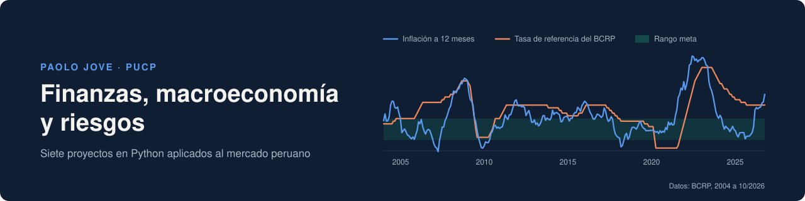
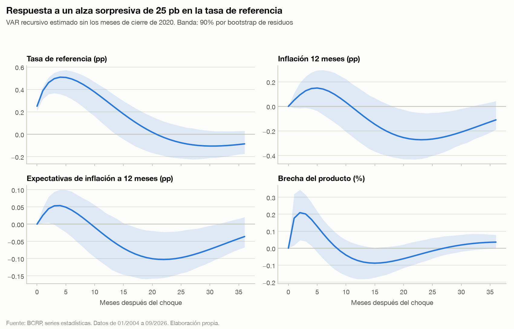
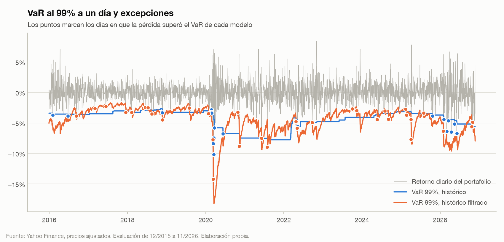
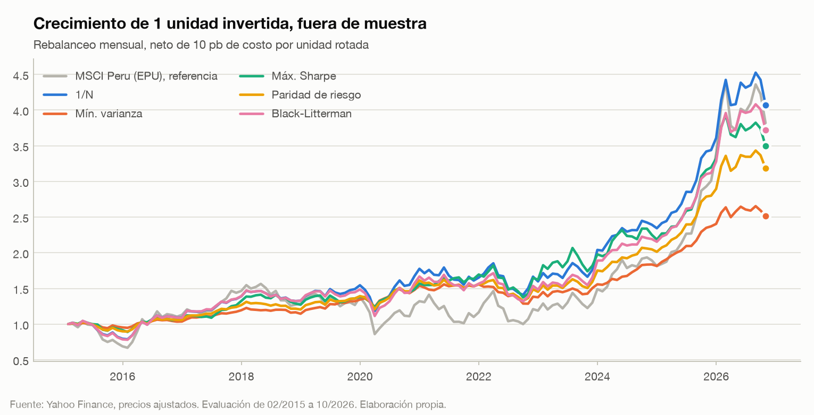
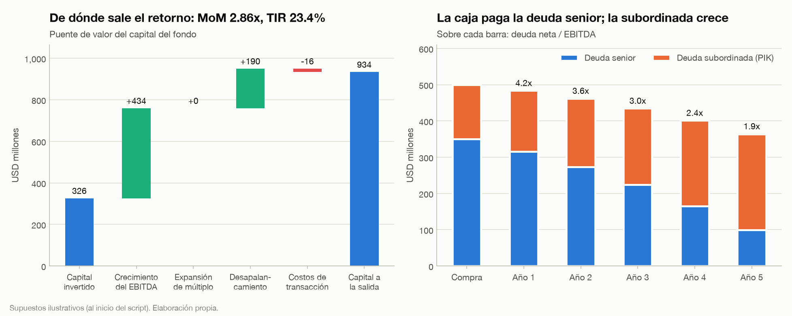
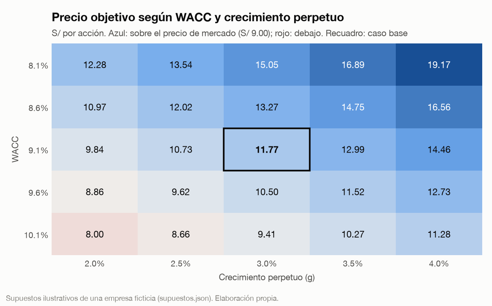
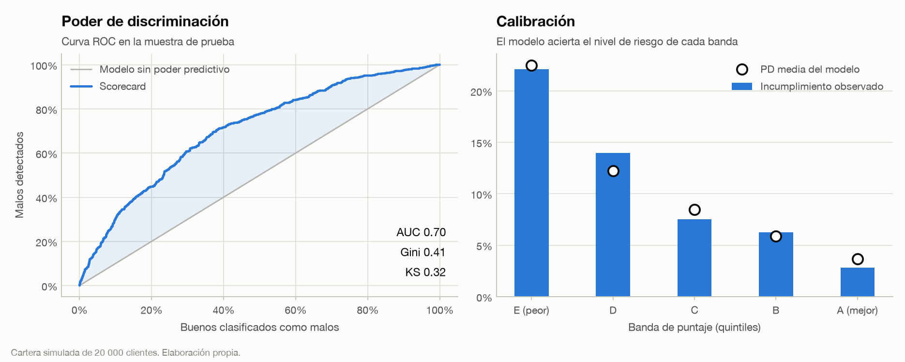
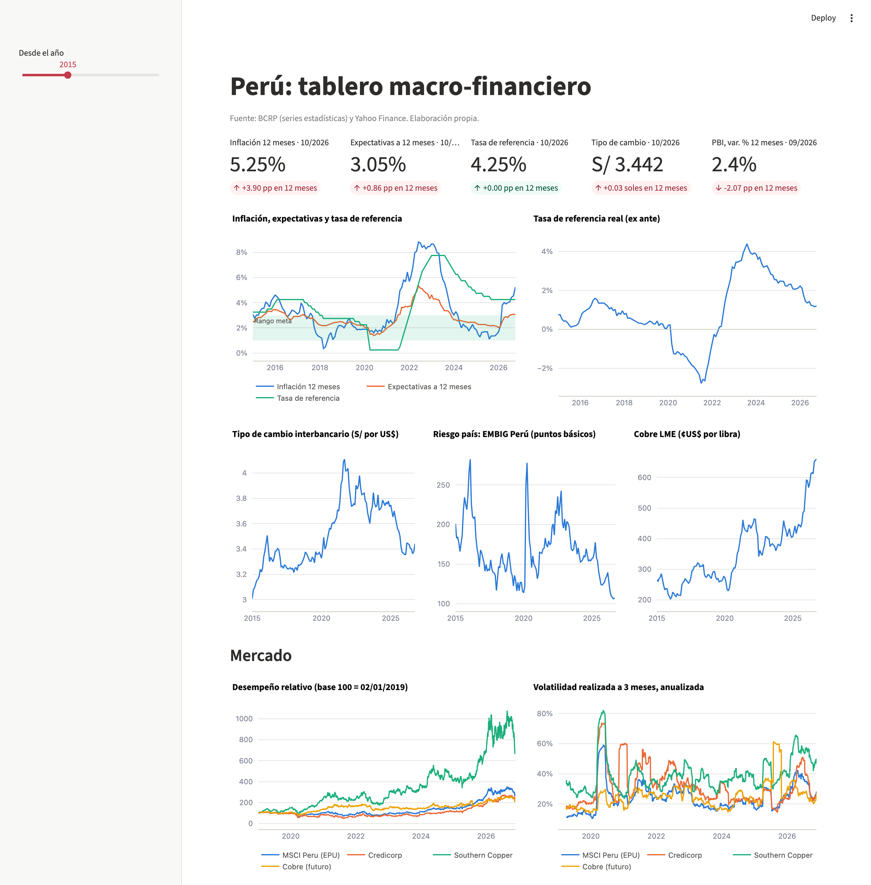

<p align="center">
  
</p>

[](https://github.com/paolojoveal/portafolio-finanzas/actions/workflows/pruebas.yml)


Siete proyectos en Python aplicados al mercado peruano. Cubren valorización, gestión de portafolios, riesgo de mercado y de crédito, política monetaria y finanzas corporativas. Cada uno responde una pregunta concreta, corre con un solo comando, declara sus supuestos y sus límites, y tiene pruebas automáticas que verifican los cálculos.

## Los proyectos

| # | Proyecto | Pregunta | Resultado principal |
|---|---|---|---|
| 01 | [Valorización DCF](01-valorizacion-dcf) | ¿Cuánto vale la acción y qué tan sensible es esa cifra a los supuestos? | Dos métodos de valor terminal que se controlan entre sí: S/ 11.77 y S/ 11.49 por acción (empresa ficticia) |
| 02 | [Optimización de portafolio](02-optimizacion-portafolio) | ¿Le gana un portafolio optimizado a repartir en partes iguales? | En 141 meses fuera de muestra, no con claridad: 1/N y paridad de riesgo empatan en Sharpe (0.55 y 0.56) y máximo Sharpe rota el portafolio 2.2 veces al año |
| 03 | [VaR y backtesting](03-var-backtesting) | ¿Qué modelo de VaR sobrevive a las pruebas regulatorias? | De cinco modelos, solo el histórico filtrado pasa Kupiec y Christoffersen en 2 743 días |
| 04 | [Inflación y política monetaria](04-inflacion-bcrp) | ¿A qué responde el BCRP y cuánto tarda la tasa en bajar la inflación? | Responde a las expectativas (φ = 3.0), no a la inflación del mes (φ = 1.0); el efecto máximo llega a los dos años |
| 05 | [Scorecard de crédito](05-riesgo-credito) | ¿Cómo se convierte una cartera en puntajes, bandas y pérdida esperada? | Gini 0.41, KS 0.32 y una tarjeta de puntos que reproduce el modelo al centavo |
| 06 | [Tablero macro-financiero](06-dashboard-macro) | ¿Qué mira un analista cada mañana? | Aplicación de Streamlit con datos en vivo del BCRP y de Yahoo Finance |
| 07 | [Finanzas corporativas avanzadas](07-lse-fm350) | ¿Cuánta deuda, a qué precio comprar y cómo pagar? | Estructura de capital (APV), LBO (TIR 23.4%), venture capital y M&A |

Resultados con datos descargados el 25 de noviembre de 2026. Los proyectos 01, 05 y 07 usan supuestos ilustrativos o datos simulados, y lo dicen en cada figura.

## Galería

<table>
  <tr>
    <td width="50%"><a href="04-inflacion-bcrp"></a><br><sub><b>04 ·</b> Qué pasa después de un alza de 25 pb en la tasa de referencia</sub></td>
    <td width="50%"><a href="03-var-backtesting"></a><br><sub><b>03 ·</b> VaR al 99% y los días en que la pérdida lo superó</sub></td>
  </tr>
  <tr>
    <td><a href="02-optimizacion-portafolio"></a><br><sub><b>02 ·</b> Cinco estrategias fuera de muestra, netas de costos</sub></td>
    <td><a href="07-lse-fm350"></a><br><sub><b>07 ·</b> De dónde sale el retorno de un LBO</sub></td>
  </tr>
  <tr>
    <td><a href="01-valorizacion-dcf"></a><br><sub><b>01 ·</b> Sensibilidad del precio objetivo</sub></td>
    <td><a href="05-riesgo-credito"></a><br><sub><b>05 ·</b> Discriminación y calibración del scorecard</sub></td>
  </tr>
  <tr>
    <td colspan="2"><a href="06-dashboard-macro"></a><br><sub><b>06 ·</b> Tablero macro-financiero del Perú</sub></td>
  </tr>
</table>

## Cómo correrlo

```bash
git clone https://github.com/paolojoveal/portafolio-finanzas.git
cd portafolio-finanzas
python -m venv .venv && source .venv/bin/activate   # en Windows: .venv\Scripts\activate
pip install -r requirements.txt
```

```bash
python 03-var-backtesting/var_backtesting.py          # datos reales
python 03-var-backtesting/var_backtesting.py --demo   # datos simulados, sin conexión
```

Los proyectos 02, 03, 04 y 06 descargan datos del BCRP y de Yahoo Finance, los guardan en `data/` y aceptan `--demo` para correr sin conexión. Cada script escribe sus figuras y tablas en la carpeta `resultados/` de su proyecto.

Para correr las pruebas:

```bash
pip install -r requirements-dev.txt
pytest
```

## Cómo está hecho

- **Datos que se verifican solos.** Cada serie del BCRP se pide por separado y se comprueba que el nombre oficial que devuelve la API sea el esperado. La API devuelve las series de un pedido conjunto en su propio orden, así que confiar en la posición etiqueta la tasa de referencia como inflación sin que nada falle. Las descargas se reintentan y una descarga incompleta nunca se guarda en caché ([`common/data.py`](common/data.py)).
- **Pruebas con respuesta conocida.** Más de 50 pruebas en [`tests/`](tests): el VAR propio da los mismos coeficientes que `statsmodels`, el ES de la t de Student coincide con una simulación, la regla de Taylor recupera los parámetros de una economía simulada, el backtest no usa información futura y la tarjeta de puntaje suma exactamente el puntaje del modelo.
- **Integración continua.** GitHub Actions corre las pruebas y los nueve scripts en cada cambio.
- **Un solo estilo gráfico.** Todas las figuras salen de [`common/estilo.py`](common/estilo.py): el color cumple una función (identidad, magnitud o signo), un solo eje por gráfico y la fuente de los datos al pie.
- **Límites a la vista.** Cada README dice qué supuestos sostienen el resultado y qué no se puede concluir de él.

## Estructura

```
common/data.py                Descarga y validación de series del BCRP y precios de mercado
common/estilo.py              Estilo gráfico común
01-valorizacion-dcf/          Modelo DCF y supuestos.json
02-optimizacion-portafolio/   Cinco estrategias y backtest fuera de muestra
03-var-backtesting/           Cinco modelos de VaR y su validación
04-inflacion-bcrp/            Regla de Taylor, VAR recursivo y pronóstico
05-riesgo-credito/            Scorecard, validación y pérdida esperada
06-dashboard-macro/           Aplicación de Streamlit
07-lse-fm350/                 Estructura de capital, LBO, venture capital y M&A
tests/                        Pruebas automáticas
```

## Sobre mí

**Paolo Jove** · Estudiante de 8.º semestre (por iniciar el 9.º) en la **Pontificia Universidad Católica del Perú (PUCP)**. Cursé **FM350 Advanced Corporate Finance** en el **LSE Summer School** (London School of Economics).

Busco prácticas pre-profesionales en Banca de Inversión, Asset Management, Finanzas Corporativas, Estudios Económicos y Gestión de Riesgos en Lima.

[LinkedIn](https://www.linkedin.com/in/paolo-jove-085647127)
